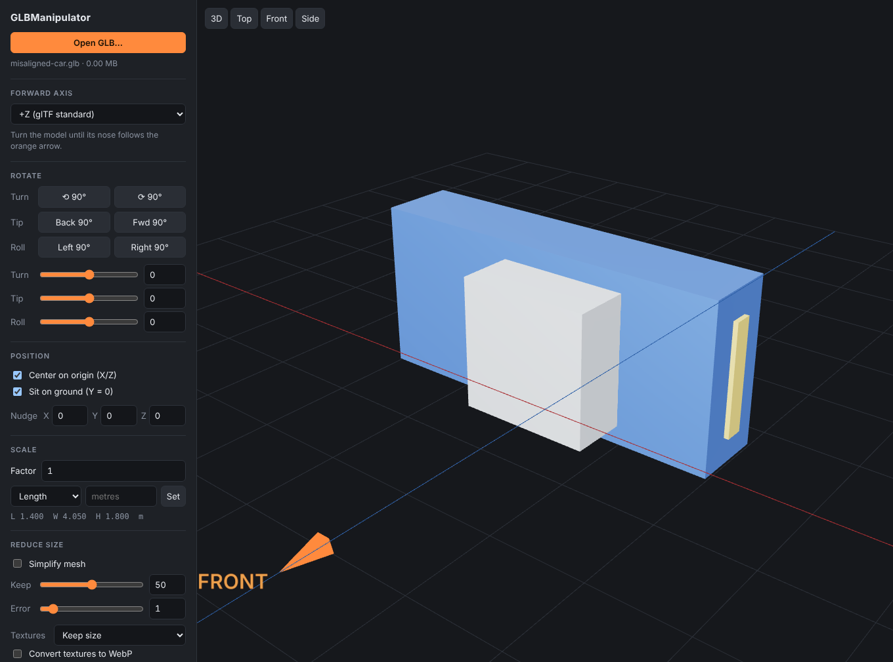
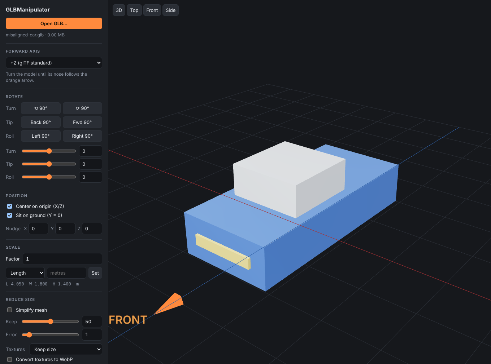

# GLBManipulator

[](https://github.com/StevenPG/GLBManipulator/actions/workflows/ci.yml)
[](https://github.com/StevenPG/GLBManipulator/actions/workflows/docker.yml)
[](LICENSE)

A small local web tool for fixing GLB models that arrive facing the wrong way,
sitting off-centre, floating above the ground, at the wrong scale, or far
larger than they need to be.

Drop a `.glb` in, line it up against a ground grid and a "front" arrow, and
export a corrected file. Everything runs on your machine; models are never
uploaded anywhere.

| Before | After two key presses |
| --- | --- |
|  |  |

Built with [glTF Transform](https://gltf-transform.dev/) and
[three.js](https://threejs.org/). This project was written with Claude.

## Features

- **Re-orient**: 90° snap buttons and fine sliders for turn, tip and roll, with
  a selectable forward axis (+Z, the glTF convention, by default).
- **Recenter and ground**: put the bounding-box centre on the origin and the
  lowest point at Y = 0, with manual X/Y/Z nudges.
- **Rescale**: by factor, or by setting the real length, width or height in metres.
- **Reduce size**: mesh simplification, texture downscaling and WebP
  conversion, Draco or Meshopt compression, with a before/after preview.
- **Non-destructive by default**: the correction is written as a single root
  node, so animations, skins, materials and existing compression survive.
  Optionally bake it into the vertices instead.
- **Scriptable**: the same pipeline is exposed as one HTTP endpoint.

## Quick start

### Docker

```sh
docker run --rm -p 127.0.0.1:5199:5199 ghcr.io/stevenpg/glbmanipulator:latest
```

Then open <http://localhost:5199>. To build the image yourself:

```sh
git clone https://github.com/StevenPG/GLBManipulator.git
cd GLBManipulator
docker compose up --build -d
```

More options (Compose, configuration, running behind a proxy) are in
[docs/docker.md](docs/docker.md).

### Node

Requires Node 20 or newer.

```sh
git clone https://github.com/StevenPG/GLBManipulator.git
cd GLBManipulator
npm install
npm start
```

Then open <http://127.0.0.1:5199>.

## Using it

1. Drop a `.glb` on the window, or click **Open GLB…**. A sample lives at
   [`examples/models/misaligned-car.glb`](examples/models).
2. Pick the **forward axis** the app you are exporting for expects.
3. **Rotate** until the model's nose follows the orange FRONT arrow. The
   **Top** view is the easiest place to judge it.

   | Key | Action |
   | --- | --- |
   | `Q` / `E` | Turn 90° left / right |
   | `W` / `S` | Tip 90° forward / back |
   | `A` / `D` | Roll 90° left / right |

4. **Center** and **Sit on ground** are on by default. Use the nudge fields
   when the bounding-box centre is not the centre you want, for example when
   a mirror or antenna sticks out on one side.
5. Optionally **rescale** and **reduce size** (see below).
6. **Export aligned GLB** downloads `<name>_aligned.glb`. The original file is
   never modified.

### Reducing size

All optional, and applied on export together with the alignment.

| Option | What it does | Watch out for |
| --- | --- | --- |
| Simplify mesh | meshoptimizer edge-collapse. *Keep* is the triangle target; *Error* caps how far the surface may move, as a percentage of mesh size. | It stops at whichever limit is hit first, so raise *Error* if the count barely drops. Hard-edged detail degrades first. |
| Textures | Caps resolution and/or converts to WebP. Often the biggest saving. | WebP needs a loader that supports `EXT_texture_webp`. KTX2 textures are left alone. |
| Compress | Draco or Meshopt geometry compression, or *None* to strip existing compression. | The app loading the file needs the matching decoder. |

**Preview result** runs the reduction and swaps it into the viewer with
before/after triangle counts and file size. Duplicate meshes, materials and
textures are always merged, which is lossless.

### How the fix is written

By default the scene's contents are moved under a new `realign_root` node that
carries the correction. Nothing else in the file changes.

**Bake into geometry** additionally rewrites the vertices so that every node
transform is identity. This flattens the node hierarchy, and is skipped (with
a message, falling back to the root node) for animated, skinned or
GPU-instanced models.

## HTTP API

The UI is a thin client over one endpoint, which you can call directly:

```sh
curl -X POST http://127.0.0.1:5199/api/realign \
  -H 'x-matrix: [0,0,1,0, 1,0,0,0, 0,1,0,0, -3.9,-2,-9.025,1]' \
  -H 'x-optimize: {"simplify":{"ratio":0.5,"error":0.01},"compression":"draco"}' \
  --data-binary @examples/models/misaligned-car.glb \
  -o car_aligned.glb
```

See [examples/](examples/README.md) for the full header reference and more recipes.

## Configuration

Environment variables read by the server:

| Variable | Default | Purpose |
| --- | --- | --- |
| `HOST` | `127.0.0.1` (`0.0.0.0` in the Docker image) | Interface to bind |
| `PORT` | `5199` | Port to listen on |
| `MAX_UPLOAD_MB` | `1024` | Largest GLB accepted |

> [!WARNING]
> There is no authentication. Keep the server bound to loopback, as the
> examples here do, unless you are on a network you trust.

## Development

```sh
npm run dev      # Vite dev server with hot reload, API included
npm test         # pipeline and HTTP API tests
npm run build    # production build into dist/
npm run serve    # serve an existing build
npm run sample   # regenerate the sample model
```

```
index.html, src/     browser UI (three.js viewer and controls)
server/realign.js    the glTF Transform pipeline: align, bake, optimise
server/app.js        HTTP handlers shared by the dev and production servers
server/index.js      production server
test/                pipeline and API tests
examples/            sample model, API recipes, Compose file
docs/                Docker guide and screenshots
```

## Contributing

Bug reports and pull requests are welcome. Please read
[CONTRIBUTING.md](CONTRIBUTING.md) and the [Code of Conduct](CODE_OF_CONDUCT.md)
first. Security issues: see [SECURITY.md](SECURITY.md).

## License

[MIT](LICENSE) © StevenPG. You may use, modify and redistribute this software,
provided the copyright and license notice are kept in all copies.

Third-party libraries keep their own licenses, including glTF Transform (MIT),
three.js (MIT), meshoptimizer (MIT), Draco (Apache-2.0) and sharp (Apache-2.0).
